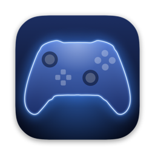
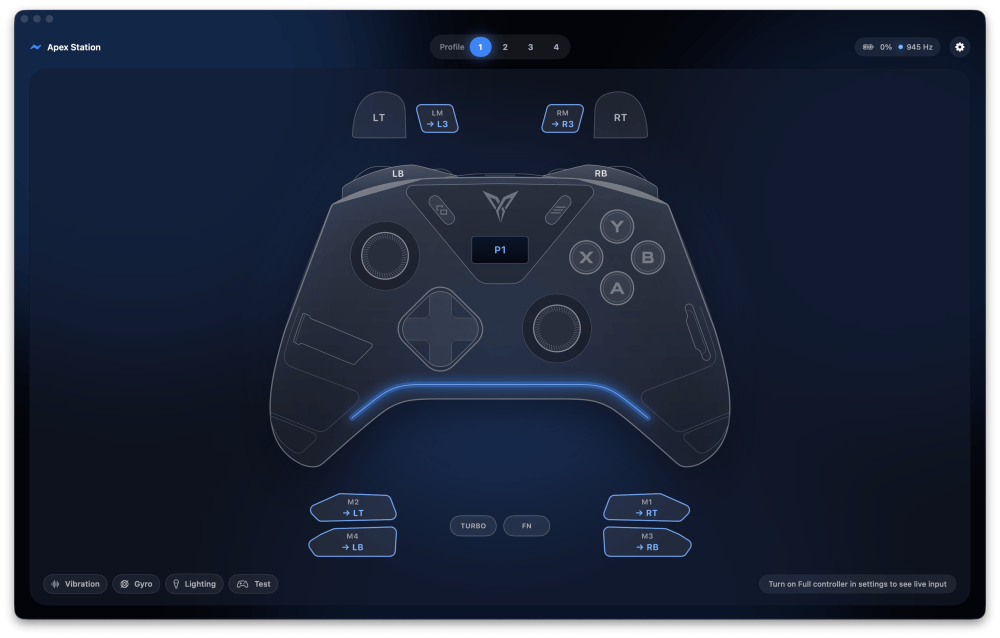

<p align="center"></p>

<h1 align="center">Apex Station</h1>

<p align="center">
  A free, open-source Mac app for the <b>Flydigi Apex 5</b>.<br>
  What Space Station does on Windows: remaps, back paddles, macros, sticks, triggers, gyro and lighting.
</p>

<p align="center">
  <a href="https://github.com/Mergemat/apex-station/releases/latest"></a>
</p>

<p align="center">
  <a href="https://github.com/Mergemat/apex-station/actions/workflows/ci.yml"></a>
  
  <a href="LICENSE"></a>
</p>

<p align="center"></p>

Everything is stored **on the controller**, so the app doesn't need to be running while you play,
and your setup follows the controller to any computer.

## Install

1. Download `Apex-Station-x.y.z.zip` from the [latest release](https://github.com/Mergemat/apex-station/releases/latest),
   unzip it, and move **Apex Station** to Applications.
2. The app isn't notarised by Apple, so macOS blocks it the first time. Open it once, then go to
   **System Settings → Privacy & Security** and click **Open Anyway**. Or run this in Terminal:
   ```sh
   xattr -dr com.apple.quarantine "/Applications/Apex Station.app"
   ```
3. Plug in the Apex 5 with a USB-C cable and set it to **PC → Wired** on the controller.

Needs macOS 15 or later, on Apple Silicon or Intel. No drivers or system extensions. Keyboard and
mouse mapping asks for Accessibility permission; nothing else needs any. Apex Station lives in the
menu bar.

## What it does

Click any part of the controller to change it.

- **Buttons and paddles:** click Assign and press the button it should act as. Works for every
  button, including M1–M4, LM and RM. Turbo that fires while held or toggles on and off, at 1–30
  presses a second.
- **Macros:** record a sequence by pressing buttons on the controller, or build it tap by tap.
  Play it once, repeat it while held, or toggle it. Up to 5 per profile.
- **Sticks:** a response curve you drag into shape (dead zone, anti-dead zone, bends, full-output
  point), the Default/Instant/Delay presets, circle or square, precision (8–12 bit) and
  sensitivity. A circularity test shows how far the stick reaches in every direction.
- **Triggers:** start and end points, and the force-feedback modes: racing, recoil, sniper, lock
  and vibration.
- **Vibration, gyro and lighting:** motor strength, gyro as a stick or mouse with an activation
  button, and light-bar colours, effects and brightness.
- **Keyboard and mouse:** buttons to keys, clicks or scrolling, sticks to WASD, arrows or the
  pointer, and gyro to the pointer. Like on Windows, this works while the app runs.
- **Screen:** your own picture or GIF on the controller's display (up to 150 frames).
- **Profiles:** all four on-board profiles, with switching, renaming, reset, and export/import
  as files.
- **Controller settings:** polling rate (up to 1000 Hz), sleep timer, Fast Swap, and Home as the
  Xbox button.
- **Live view:** every button, stick, trigger and the real polling rate as you press, over the
  cable, the 2.4 GHz receiver or PC Bluetooth.
- **Backups:** every profile is saved to your Mac before anything on the controller changes.

Settings need the cable or the receiver. In PC Bluetooth mode the controller is a plain Xbox pad
with no settings channel.

## Playing games on a Mac

There are a few ways for games to see the controller:

| Connection | What games see | Needs |
| --- | --- | --- |
| Cable, PC mode, with Apex Station's Xbox controller on | An **Xbox Wireless Controller** with the controller's own remaps, gyro-to-stick, macros and turbo, at about 1000 Hz, with rumble. Every game sees it: Game Controller framework, Unity, SDL, Steam. | AMFI relaxed (below) |
| Cable, PC mode | "Flydigi Apex 5", read directly by Steam and SDL 3.4+ games, with back paddles and gyro but without the controller's own remaps | Nothing |
| PC Bluetooth | A standard Xbox controller, with Bluetooth latency | Nothing |
| Switch → Wired | A Pro Controller, at about 100 Hz | Nothing |

Turn the Xbox controller on in **Settings → Xbox controller for games**. It keeps running from the
menu bar with the window closed; turn on **Open at login** to always have it. While it's on, the app
hides the controller's own "Flydigi Apex 5" from Steam and SDL so games don't see it twice.

<details>
<summary>Why it needs AMFI relaxed</summary>

macOS only lets Apple-signed apps create a virtual controller, and Apex Station isn't signed by
Apple. The part that does it is a small helper inside the app, so the app itself opens on any Mac.
The helper needs AMFI relaxed:

```sh
sudo nvram boot-args="amfi_get_out_of_my_way=1"   # then restart
```

On Apple Silicon this also needs System Integrity Protection off. It loosens code-signing checks
for the whole Mac, so only do it if you're comfortable with that. Without it, Settings says so and
the other three ways above still work.
</details>

## Build it yourself

You need Apple's Command Line Tools (`xcode-select --install`) and [Bun](https://bun.sh). Xcode
isn't needed.

```sh
bun run test          # protocol tests, using data captured from a real Apex 5
bun run build         # build/Apex Station.app
bun run install-app   # build and copy to /Applications
bun run release       # universal build, zipped for download
bun scripts/icon.ts   # re-render the app icon
```

`Sources/ApexKit` holds the controller protocol: profile, lighting, macro and settings formats.
It has no UI and no hardware access, so it can be reused. `Sources/ApexStation` is the app.
See [CONTRIBUTING.md](CONTRIBUTING.md) before sending a pull request.

### The stock screen animation

The screen's stock animation is Flydigi's artwork, so it isn't included. To get it back, copy it
out of Space Station's Windows installer (needs `brew install innoextract`):

```sh
bun scripts/screen-default.ts ss4_setup.exe
```

The app then offers **Restore Flydigi animation**.

## Safety

The app only uses the commands Space Station uses for settings, profiles, lighting and the
screen. It never writes firmware: for the screen it uses the screen chip's update mode the way
Space Station does, and the chip only takes pictures into its picture area. Each change writes
only the bytes that differ, reads the profile back so the app shows what the controller stored,
and keeps a backup in `~/Library/Application Support/Apex Station/Backups`.

## Licence

[MIT](LICENSE). Not affiliated with Flydigi.
